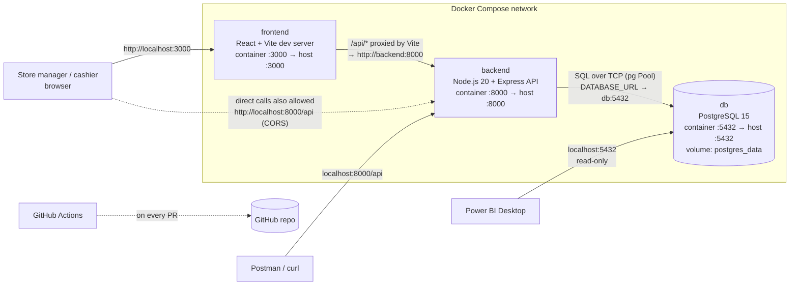

# 03. System Architecture

| | |
|---|---|
| **Owners** | Joseph (application), Nana Yaw (runtime) |
| **Status** | Agreed v1.0, matching the Compose file merged on `main` |

---

## 1. Containers and ports



| Service (Compose name) | Container name | Image / build | Host port | Purpose |
|------------------------|----------------|---------------|-----------|---------|
| `db` | `campus_store_db` | `postgres:15-alpine` | 5432 | Stores categories, products, sales. Runs `database/*.sql` on first start. |
| `backend` | `campus_store_backend` | `./backend` (Node 20 alpine) | 8000 | REST API under `/api`. The only component that writes to the database. |
| `frontend` | `campus_store_frontend` | `./frontend` (Node 20 alpine) | 3000 | React + Vite web app |

**Inside the Compose network, services reach each other by service name:** the backend connects to `db:5432`, and the frontend dev server proxies to `backend:8000`. **From your laptop**, use `localhost` and the host port.

---

## 2. Responsibilities

| Component | Does | Does **not** |
|-----------|------|--------------|
| Frontend | Forms, lists, dashboard; light input checks; shows API errors; refreshes after changes | Calculate stock, low-stock status or KPIs (it displays what the API returns) |
| Backend | Validates input; applies business rules (stock, price snapshot); transactions; KPI maths in SQL; consistent JSON errors | Render HTML; store sessions or files |
| Database | Holds the data; enforces keys, `CHECK`s and uniqueness as a safety net | Deduct stock for new sales (no triggers for that; the API does it) |
| Analytics (SQL / Power BI) | Read-only analysis and dashboards | Write data |

**Single writer:** only the API writes. So every business rule lives in one place, the database constraints back it up, and the app and Power BI can't disagree about how data was written.

---

## 3. Key flow: record a sale

```mermaid
sequenceDiagram
    autonumber
    actor C as Cashier
    participant FE as Frontend (Record Sale)
    participant API as Backend API
    participant DB as PostgreSQL

    C->>FE: choose product, qty 2, mobile money, Save
    FE->>API: POST /api/sales {product_id, quantity, payment_method}
    API->>API: validate (zod)
    API->>DB: BEGIN
    API->>DB: UPDATE products SET stock_quantity = stock_quantity - 2<br/>WHERE id = $1 AND stock_quantity >= 2 RETURNING price, …
    alt no row updated
        API->>DB: ROLLBACK
        API-->>FE: 404 NOT_FOUND or 409 INSUFFICIENT_STOCK
        FE-->>C: "Only 1 unit of 'Campus Hoodie' in stock; cannot sell 2."
    else stock decreased
        API->>DB: INSERT INTO sales (…, unit_price = price) RETURNING …
        API->>DB: COMMIT
        API-->>FE: 201 {data: sale + product_stock_after + is_low_stock}
        FE-->>C: "Sale recorded" (+ low-stock warning if flagged)
        FE->>API: refresh products and summary
    end
```

## 4. Key flow: dashboard

1. The Dashboard page calls `GET /api/summary` (optionally `?from=&to=`).
2. The API runs three queries (totals, top 5, low-stock count) in one read-only `REPEATABLE READ` transaction, so all figures come from the same snapshot.
3. Power BI and Samuel's `kpi_summary.sql` use the **same definitions** ([05 §7.2](05-api-reference.md#72-metric-definitions-identical-in-the-api-sql-and-power-bi)), so the figures match.

---

## 5. Technology stack

| Layer | Choice | Version source |
|-------|--------|----------------|
| Frontend | React + Vite, JavaScript, CSS, Fetch API | Cecilia's frontend design |
| Backend runtime | Node.js 20 (alpine) | `backend/Dockerfile` on `main` |
| Web framework | Express 5 | Backend decision ADR-001 ([10](10-decisions-and-alignment-log.md)) |
| DB driver | `pg` (node-postgres), hand-written parameterised SQL, no ORM | ADR-002 |
| Validation | zod 4 | ADR-003 |
| Tests | Vitest + Supertest against a real Postgres | ADR-009 |
| Database | PostgreSQL 15 (`postgres:15-alpine`) | `docker-compose.yml` on `main` |
| Containers | Docker + Docker Compose | brief |
| CI | GitHub Actions | `.github/workflows/ci.yml` on `main` |
| Analytics | SQL + Power BI Desktop | brief |

---

## 6. Environment variables (summary)

The full table is in [09 §3](09-environment-and-setup.md#3-environment-variables).

| Variable | Used by | Example |
|----------|---------|---------|
| `POSTGRES_USER`, `POSTGRES_PASSWORD`, `POSTGRES_DB` | db (and to build `DATABASE_URL`) | `store_admin`, *(secret)*, `campus_store` |
| `DATABASE_URL` | backend | `postgresql://store_admin:***@db:5432/campus_store` |
| `PORT` | backend | `8000` |
| `CORS_ORIGIN` | backend | `http://localhost:3000,http://localhost:5173` |
| `NODE_ENV` | backend | `development` / `test` / `production` |
| `VITE_API_URL` | frontend | `/api` (proxied) or `http://localhost:8000/api` |
| `API_PROXY_TARGET` | frontend (Vite dev server) | `http://backend:8000` in Docker, `http://localhost:8000` locally |

---

## 7. Cross-cutting decisions

| Topic | Decision |
|-------|----------|
| API style | REST, JSON, `snake_case` fields matching DB columns, base path `/api` |
| Errors | One shape everywhere: `{ "error": { "code", "message", "details?" } }` |
| Money | `NUMERIC(10,2)` in the DB; JSON numbers in the API; `GHS 1,234.50` in the UI |
| Time | `TIMESTAMPTZ` in the DB; ISO 8601 UTC strings in the API; date filters `YYYY-MM-DD` |
| Consistency | Stock changes and sale writes happen in one transaction; guarded `UPDATE` prevents overselling under concurrency |
| Security | Parameterised SQL; `ORDER BY` whitelist; no client-supplied prices; no stack traces in responses; secrets only in `.env` |
| Observability | Request log line per request; `/api/health` checks the DB |
