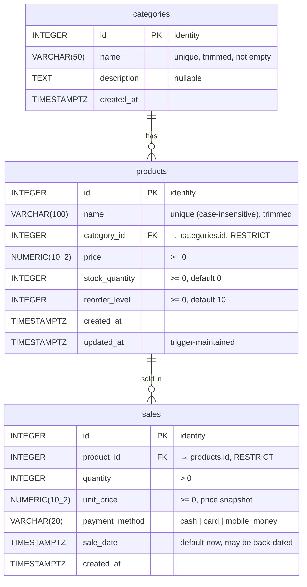

# 04. Database Schema

| | |
|---|---|
| **Owner** | Samuel (Data) |
| **Consumers** | Joseph (API), Samuel (analytics, Power BI) |
| **Canonical files** | `database/init.sql`, `database/seed.sql`, `database/verify.sql` (on the `database` branch, commit `22143c5`) |
| **Basis** | Joseph's schema change request (12 Oct 2026), adopted in Samuel's alignment report |
| **Engine** | PostgreSQL 15 (`postgres:15-alpine` in Compose) |
| **Status** | **Frozen v1.0.** Changes follow [02 §5](02-team-workflow-and-repo-structure.md#5-changing-an-agreed-contract). |

This document describes the schema **as implemented** by Samuel. If it ever differs from `database/init.sql`, the SQL file wins and this document must be corrected.

---

## 1. Entity-relationship diagram



---

## 2. Tables

### 2.1 `categories`
| Column | Type | Null | Default | Rules |
|--------|------|:----:|---------|-------|
| `id` | `INTEGER GENERATED ALWAYS AS IDENTITY` | no | identity | PK |
| `name` | `VARCHAR(50)` | no | n/a | `UNIQUE` (case-sensitive); `name = btrim(name) AND name <> ''` |
| `description` | `TEXT` | yes | `NULL` | n/a |
| `created_at` | `TIMESTAMPTZ` | no | `CURRENT_TIMESTAMP` | n/a |

### 2.2 `products`
| Column | Type | Null | Default | Rules |
|--------|------|:----:|---------|-------|
| `id` | `INTEGER GENERATED ALWAYS AS IDENTITY` | no | identity | PK |
| `name` | `VARCHAR(100)` | no | n/a | trimmed and not empty; **unique on `LOWER(name)`** (index `uq_products_name_lower`) |
| `category_id` | `INTEGER` | no | n/a | FK → `categories(id)` `ON DELETE RESTRICT` |
| `price` | `NUMERIC(10,2)` | no | n/a | `>= 0` |
| `stock_quantity` | `INTEGER` | no | `0` | `>= 0` |
| `reorder_level` | `INTEGER` | no | `10` | `>= 0` |
| `created_at` | `TIMESTAMPTZ` | no | `CURRENT_TIMESTAMP` | n/a |
| `updated_at` | `TIMESTAMPTZ` | no | `CURRENT_TIMESTAMP` | set on every `UPDATE` by trigger `trg_products_updated_at` |

### 2.3 `sales`
One row = one product sold in a given quantity. There is no `sales_items` table.

| Column | Type | Null | Default | Rules |
|--------|------|:----:|---------|-------|
| `id` | `INTEGER GENERATED ALWAYS AS IDENTITY` | no | identity | PK |
| `product_id` | `INTEGER` | no | n/a | FK → `products(id)` `ON DELETE RESTRICT` |
| `quantity` | `INTEGER` | no | n/a | `> 0` |
| `unit_price` | `NUMERIC(10,2)` | no | n/a | `>= 0`; copy of `products.price` at the time of sale |
| `payment_method` | `VARCHAR(20)` | no | n/a | `IN ('cash','card','mobile_money')` |
| `sale_date` | `TIMESTAMPTZ` | no | `CURRENT_TIMESTAMP` | when the sale happened (may be back-dated) |
| `created_at` | `TIMESTAMPTZ` | no | `CURRENT_TIMESTAMP` | when the row was recorded |

The line total (`quantity * unit_price`) is **computed in queries, not stored**.

### 2.4 Indexes
| Name | On | Why |
|------|----|-----|
| PK indexes | `id` of each table | automatic |
| `uq_categories_name` | `categories(name)` | unique category names |
| `uq_products_name_lower` | `products(LOWER(name))` | unique product names, ignoring case |
| `idx_products_category_id` | `products(category_id)` | filter products by category |
| `idx_sales_product_id` | `sales(product_id)` | sales per product, top products |
| `idx_sales_sale_date` | `sales(sale_date)` | date-range filters and monthly reports |

### 2.5 Constraint names (the API maps these to messages)
| Constraint | Table | SQLSTATE when violated | API response |
|------------|-------|------------------------|--------------|
| `uq_categories_name` | categories | `23505` | 409 `DUPLICATE` |
| `uq_products_name_lower` | products | `23505` | 409 `DUPLICATE` ("A product named '…' already exists.") |
| `products_category_id_fkey` | products | `23503` on insert/update | 400 `VALIDATION_ERROR` (field `category_id`) |
| `sales_product_id_fkey` | sales | **`23001`** (`restrict_violation`) on delete of a sold product | 409 `IN_USE` |
| `chk_products_*`, `chk_sales_*`, `chk_categories_name_trim` | various | `23514` | 400 `VALIDATION_ERROR` |

The FK names are PostgreSQL's defaults (`<table>_<column>_fkey`), because `init.sql` declares the FKs inline.

> ⚠️ Because the FKs use `ON DELETE RESTRICT`, deleting a referenced row raises **`23001`**, not the `23503` you get with the default `NO ACTION`. This was verified by running the schema on 13 Oct 2026, and the API handles both codes.

---

## 3. Business rules enforced where

| Rule | Database | API |
|------|----------|-----|
| Stock never negative | `CHECK (stock_quantity >= 0)` (safety net) | guarded `UPDATE … WHERE stock_quantity >= qty` → 409 |
| Price snapshot on sale | `sales.unit_price NOT NULL` | API copies `products.price`; the client can't send it |
| Deduct stock for new sales | ❌ not done by the DB (no trigger) | ✅ API, in the same transaction as the `INSERT` |
| Restore stock on cancel | ❌ | ✅ API: `DELETE … RETURNING` then `UPDATE` in one transaction |
| Can't delete a sold product | `ON DELETE RESTRICT` | maps `23001` → 409 `IN_USE` |
| Unique product names | `uq_products_name_lower` | maps `23505` → 409 `DUPLICATE` |
| Names trimmed / non-empty | `CHECK (name = btrim(name) AND name <> '')` | zod trims before insert, so the check never fires in practice |
| Low stock | n/a (no column) | `is_low_stock = stock_quantity <= reorder_level` |
| `updated_at` refresh | trigger `trg_products_updated_at` | API never sets it |

---

## 4. Schema SQL (`database/init.sql`)

Reproduced from the `database` branch for reference. **Do not edit here.** Edit `database/init.sql` through a PR.

```sql
BEGIN;

CREATE TABLE categories (
    id          INTEGER GENERATED ALWAYS AS IDENTITY PRIMARY KEY,
    name        VARCHAR(50) NOT NULL,
    description TEXT,
    created_at  TIMESTAMPTZ NOT NULL DEFAULT CURRENT_TIMESTAMP,
    CONSTRAINT uq_categories_name UNIQUE (name),
    CONSTRAINT chk_categories_name_trim
        CHECK (name = BTRIM(name) AND name <> '')
);

CREATE TABLE products (
    id             INTEGER GENERATED ALWAYS AS IDENTITY PRIMARY KEY,
    name           VARCHAR(100) NOT NULL,
    category_id    INTEGER NOT NULL REFERENCES categories(id) ON DELETE RESTRICT,
    price          NUMERIC(10,2) NOT NULL,
    stock_quantity INTEGER NOT NULL DEFAULT 0,
    reorder_level  INTEGER NOT NULL DEFAULT 10,
    created_at     TIMESTAMPTZ NOT NULL DEFAULT CURRENT_TIMESTAMP,
    updated_at     TIMESTAMPTZ NOT NULL DEFAULT CURRENT_TIMESTAMP,
    CONSTRAINT chk_products_name_trim
        CHECK (name = BTRIM(name) AND name <> ''),
    CONSTRAINT chk_products_price CHECK (price >= 0),
    CONSTRAINT chk_products_stock_quantity CHECK (stock_quantity >= 0),
    CONSTRAINT chk_products_reorder_level CHECK (reorder_level >= 0)
);

-- Global product-name uniqueness, ignoring case. Handles "Pen" vs "pen".
CREATE UNIQUE INDEX uq_products_name_lower ON products (LOWER(name));

-- One sales row represents one product sold in a specified quantity.
-- The unit price is a snapshot of the price at the time of sale.
CREATE TABLE sales (
    id             INTEGER GENERATED ALWAYS AS IDENTITY PRIMARY KEY,
    product_id     INTEGER NOT NULL REFERENCES products(id) ON DELETE RESTRICT,
    quantity       INTEGER NOT NULL,
    unit_price     NUMERIC(10,2) NOT NULL,
    payment_method VARCHAR(20) NOT NULL,
    sale_date      TIMESTAMPTZ NOT NULL DEFAULT CURRENT_TIMESTAMP,
    created_at     TIMESTAMPTZ NOT NULL DEFAULT CURRENT_TIMESTAMP,
    CONSTRAINT chk_sales_quantity CHECK (quantity > 0),
    CONSTRAINT chk_sales_unit_price CHECK (unit_price >= 0),
    CONSTRAINT chk_sales_payment_method
        CHECK (payment_method IN ('cash', 'card', 'mobile_money'))
);

CREATE INDEX idx_products_category_id ON products(category_id);
CREATE INDEX idx_sales_product_id ON sales(product_id);
CREATE INDEX idx_sales_sale_date ON sales(sale_date);

-- Automatically refresh a product's modification timestamp.
-- This trigger does NOT manage sales or stock deductions.
CREATE OR REPLACE FUNCTION set_updated_at()
RETURNS TRIGGER
LANGUAGE plpgsql
AS $$
BEGIN
    NEW.updated_at := CURRENT_TIMESTAMP;
    RETURN NEW;
END;
$$;

CREATE TRIGGER trg_products_updated_at
BEFORE UPDATE ON products
FOR EACH ROW
EXECUTE FUNCTION set_updated_at();

COMMIT;
```

---

## 5. Seed data (`database/seed.sql`)

| Measure | Expected after seeding a fresh database |
|---------|----------------------------------------:|
| Categories | 6 (Beverages, Campus Merchandise, Electronics, Personal Care, Snacks, Stationery) |
| Products | 24 (4 per category), all `reorder_level = 10` |
| Sales | 200 (one every 6 hours, about 50 days back from the moment of seeding) |
| Units sold | 402 |
| Units remaining in stock | 2,043 (lowest product: 25) |
| Payment methods | card 67, mobile_money 67, cash 66 |

- The seed **refuses to run** if any table already has rows (this prevents duplicates).
- It deducts the 200 historical sales from the opening stock, then checks the totals and **rolls back** on any mismatch.
- `sale_date` values are relative to **when the seed ran** (`CURRENT_TIMESTAMP - n × 6 h`). Totals are the same on every machine, but the **month split differs** depending on when the volume was created. Reconcile on one shared database instance ([08 §4](08-testing-and-reconciliation.md#4-reconciliation-api--sql--power-bi)).
- Stable on every run: **orders 200, units 402, stock 2,043, payment split 67/67/66**. Revenue is **not yet stable** (see limitation 1).

### Known seed limitations (owner: Samuel)
1. 🔴 **Revenue depends on the order Postgres assigns product ids (fix before reconciliation).** `INSERT … SELECT … FROM (VALUES …) JOIN categories` doesn't guarantee that ids follow the `VALUES` order, and the sales allocation picks products by `ROW_NUMBER() OVER (ORDER BY id)`. **This was observed on 13 Oct 2026:** the hash join produced ids in reverse order within each category (id 1 = Iced Tea, not Bottled Water), giving **revenue 12,044.00 / AOV 60.22**. The `VALUES` order would give **12,549.50 / 62.75**. Units and stock totals still pass the seed's own checks, because they don't depend on which product is chosen.
   **Suggested fix:** add an ordinal to the `VALUES` list and insert in that order, e.g. `… FROM (VALUES (1,'Beverages','Bottled Water 500ml',5.00,180), …) AS v(ord, …) JOIN categories c ON … ORDER BY v.ord;`. Also add a revenue assertion to the seed's validation block.
2. **No low-stock products at seed time** (minimum stock 25 vs reorder level 10). To demo the alert, either record sales on the day or raise a few `reorder_level` values in the seed (e.g. Campus Hoodie 30, Phone Wall Charger 35). Decide before Sprint 2 Day 4.

---

## 6. Running and resetting

| Task | Command |
|------|---------|
| First start (creates schema and seed automatically) | `docker compose up --build` |
| Open a SQL shell | `docker compose exec db psql -U store_admin -d campus_store` |
| Run the verification queries | `docker compose exec -T db psql -U store_admin -d campus_store < database/verify.sql` |
| **Reset to a fresh seeded database** | `docker compose down -v && docker compose up --build` (⚠️ deletes all data) |

Init scripts run **only when the `postgres_data` volume is empty**. Editing `init.sql` has no effect on an existing volume until you reset.

---

## 7. Not in v1 (removed by agreement)

| Item | Why removed | If wanted later |
|------|-------------|-----------------|
| `products.is_active` | v1 blocks deletion of sold products instead | Change-control PR: add the column, filter lists, add an "archive" endpoint |
| `sales.status` (`completed` / `cancelled`) | Every revenue query would need `WHERE status = 'completed'`, which risks the app and Power BI disagreeing | Change-control PR: add the status, change cancel to an `UPDATE`, update all KPI SQL and Power BI measures together |
