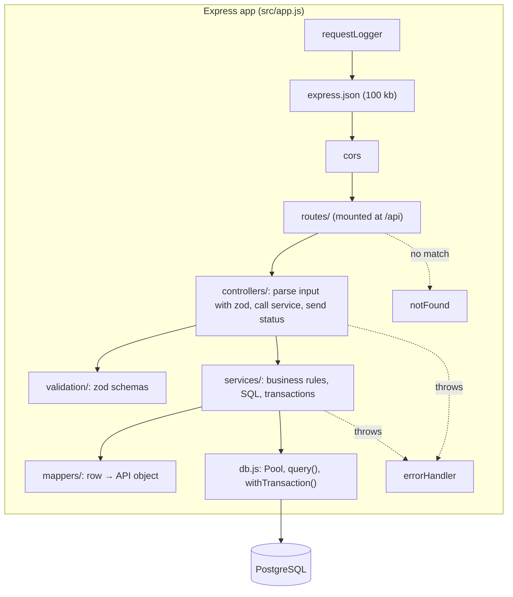

# 06. Backend Technical Design

| | |
|---|---|
| **Component** | `backend/`: Campus Store REST API |
| **Owner** | Joseph |
| **Status** | v1.0 (13 Oct 2026). Replaces `backend/sys_docs/03-backend-architecture-and-technical-design.md` (draft v0.1). |
| **Implements** | [05 API reference](05-api-reference.md) on the [04 schema](04-database-schema.md) |

**What changed from draft v0.1** to match the work already merged:

| Draft v0.1 | Now | Why |
|------------|-----|-----|
| `API_PORT=4000` | `PORT=8000` | Compose and the backend Dockerfile on `main` use 8000 |
| `DB_HOST`, `DB_PORT`, `POSTGRES_*` | **`DATABASE_URL`** | Compose and `.env.example` on `main` provide `DATABASE_URL` |
| Node 24, `postgres:16` | Node 20, `postgres:15` | Images pinned in the merged Dockerfiles and Compose |
| `src/server.js` entry | **`backend/server.js`** at root, code in `src/` | The Dockerfile runs `npm run dev` → `node --watch server.js` |
| Nginx proxy, CORS only in dev | Vite dev proxy **and** CORS | There is no Nginx in Compose; the browser may call `:8000` directly |
| Low stock `<` | **`<=`** | Matches Samuel's `verify.sql` and the database README |
| Compose service `api` | **`backend`** | Compose on `main` |

---

## 1. Scope

**In scope:** everything under `/api`: health, categories (list), products (CRUD, search, filter, sort, pagination), sales (CRUD with stock logic), summary (KPIs); validation; error handling; configuration; logging; tests; the Postman collection; API docs.

**Out of scope (v1):** authentication (stretch, [05 §9.3](05-api-reference.md#93-post-apiauthlogin-fr-62)), CSV export and the daily chart endpoint (stretch), category management.

---

## 2. Layered architecture



| Layer | Knows about | Never does |
|-------|-------------|-----------|
| Routes | URLs and verbs | contain logic |
| Controllers | `req`, `res`, status codes, which schema and which service | run SQL |
| Validation | input rules and messages | touch the DB |
| Services | business rules, SQL, transactions; throw `AppError` | touch `req`/`res` |
| Mappers | `NUMERIC` → number, computed fields (`is_low_stock`, `total`) | query |
| `db.js` | one shared pool, query and transaction helpers | per-request state |
| Middleware | parsing, CORS, logging, 404, errors | business logic |

---

## 3. Folder structure

```
backend/
├── server.js                    entry point: require('./src/server')
├── src/
│   ├── server.js                listen on PORT, graceful shutdown
│   ├── app.js                   builds and exports the Express app (tests import this)
│   ├── config.js                reads and validates env vars once
│   ├── db.js                    pg Pool, query(), withTransaction(), ping()
│   ├── errors.js                AppError + helpers (notFound, conflict, badRequest)
│   ├── routes/
│   │   └── index.js             every /api route in one readable table (13 lines of routes)
│   ├── controllers/             health, category, product, sale, summary (…Controller.js)
│   ├── services/                categoryService, productService, saleService, summaryService
│   ├── validation/
│   │   ├── common.js            id, page, limit, date, paymentMethod, saleDate, quantity
│   │   ├── products.schema.js
│   │   ├── sales.schema.js
│   │   ├── summary.schema.js
│   │   └── validate.js          parse(schema, input, message) → value or AppError 400
│   ├── mappers/index.js         toCategory, toProduct, toSale, isLowStock
│   └── middleware/              requestLogger, notFound, errorHandler
├── tests/
│   ├── helpers/resetDb.js       rebuilds schema from database/init.sql + small known fixture
│   ├── unit/                    mappers, validation
│   └── integration/             health, products, sales, summary
├── openapi.yaml                 copy of dev_docs/openapi.yaml (served at /api/docs, optional)
├── campus-store.postman_collection.json
├── eslint.config.js
├── .dockerignore
├── package.json, package-lock.json
└── Dockerfile                   Nana Yaw (Joseph reviews)
```

Module system: **CommonJS** (`require`), matching the existing `server.js`.

---

## 4. Request lifecycle

Middleware order in `app.js` (order matters):

1. `requestLogger`: logs `METHOD path status ms` when the response finishes. It goes first so requests that fail in a later middleware (malformed JSON, body too large) are still logged; an error skips every normal middleware after the one that raised it.
2. `express.json({ limit: '100kb' })`. Malformed JSON → `INVALID_JSON` (400).
3. `cors({ origin: config.corsOrigins })`
4. `app.use('/api', routes)`
5. `notFound` → 404 `ROUTE_NOT_FOUND`
6. `errorHandler` (last; four arguments)

**Example: `GET /api/products?search=pen&low_stock=true`**
1. The router matches → `productController.list`
2. The controller parses `req.query` with `listProductsQuery`, which turns `"true"` into `true` and applies `page=1, limit=20, sort=name`
3. `productService.list(filters)` builds a parameterised `WHERE` from the filters and runs the page query and `COUNT(*)`
4. Each row → `toProduct()` (price → number, `is_low_stock`)
5. `200 { data, meta }`

---

## 5. Endpoint → implementation map

| Endpoint | Controller | Service | Tx | Errors |
|----------|-----------|---------|:--:|--------|
| `GET /health` | health.check | `db.ping()` | n/a | 503 |
| `GET /categories` | categories.list | categoryService.list | n/a | n/a |
| `GET /products` | products.list | productService.list | n/a | 400 |
| `GET /products/:id` | products.get | productService.getById | n/a | 400, 404 |
| `POST /products` | products.create | productService.create | n/a | 400, 409 |
| `PUT /products/:id` | products.update | productService.update | n/a | 400, 404, 409 |
| `DELETE /products/:id` | products.remove | productService.remove | n/a | 400, 404, 409 |
| `GET /sales` | sales.list | saleService.list | n/a | 400 |
| `GET /sales/:id` | sales.get | saleService.getById | n/a | 400, 404 |
| `POST /sales` | sales.create | saleService.record | ✅ | 400, 404, 409 |
| `PUT /sales/:id` | sales.update | saleService.correct | ✅ | 400, 404, 409 |
| `DELETE /sales/:id` | sales.remove | saleService.cancel | ✅ | 400, 404 |
| `GET /summary` | summary.get | summaryService.get | read-only RR | 400 |

---

## 6. Data access

- **One `pg.Pool`** created at start-up from `DATABASE_URL` (`max: 10`). There is never a pool or client per request.
- `query(text, params)` for single statements.
- `withTransaction(async (client) => …)`: `connect` → `BEGIN` → fn → `COMMIT`; on error `ROLLBACK` and rethrow; **always `release()` in `finally`**.
- **SQL rules:**
  - Always parameterised (`$1, $2`). Search: `p.name ILIKE $n ESCAPE '\'` with the value `%term%`, after escaping `\`, `%` and `_` in the term.
  - Dynamic filters: push conditions and values into arrays; join with `AND`.
  - `ORDER BY` only from a whitelist map; never interpolate user input.
  - Explicit column lists, no `SELECT *`.
  - Product and sale queries join `categories` (and `products`) in the same statement, so there are no N+1 queries.
- **Type conversion:** `pg` returns `NUMERIC` and `COUNT(*)`/`SUM(int)` (`bigint`) as **strings**. Mappers convert with `Number()`. Alternatively cast in SQL (`COUNT(*)::int`). Never send money as a string.
- **Start-up resilience:** Compose has no DB healthcheck yet, so the backend may start before Postgres accepts connections. The pool connects lazily, so the server starts anyway. `/api/health` returns 503 until the DB is ready, and requests succeed once it is. **Do not `process.exit` on a failed first connection.**

---

## 7. Stock logic (the core business rules)

### 7.1 Record a sale: `POST /api/sales`
```sql
-- inside withTransaction
UPDATE products
   SET stock_quantity = stock_quantity - $2
 WHERE id = $1 AND stock_quantity >= $2
RETURNING id, name, price, stock_quantity, reorder_level;

-- 0 rows → SELECT name, stock_quantity FROM products WHERE id = $1
--          none → 404 NOT_FOUND; else → 409 INSUFFICIENT_STOCK (available, requested)

INSERT INTO sales (product_id, quantity, unit_price, payment_method, sale_date)
VALUES ($1, $2, $3 /* price from RETURNING */, $4, COALESCE($5, now()))
RETURNING id;
-- then SELECT the joined sale row and add product_stock_after and is_low_stock
```

**Why a guarded `UPDATE`?** If the code reads stock, checks it in JavaScript and then writes, two cashiers selling the last unit at the same moment could both pass the check. With `WHERE stock_quantity >= $2`, Postgres row-locks during the `UPDATE`: the second request waits, re-checks against the new stock, updates 0 rows, and gets 409. The check and the change are **one atomic statement**. The DB `CHECK (stock_quantity >= 0)` is a second safety net. (ADR-004.)

### 7.2 Correct a sale: `PUT /api/sales/:id`
1. `SELECT product_id, quantity FROM sales WHERE id = $1 FOR UPDATE` (404 if missing).
2. `delta = newQuantity − oldQuantity` (0 if quantity isn't in the body).
3. `delta > 0` → guarded decrement by `delta` (409 if short). `delta < 0` → `UPDATE products SET stock_quantity = stock_quantity + |delta|`.
4. `UPDATE sales SET quantity = COALESCE($q, quantity), payment_method = COALESCE($pm, payment_method), sale_date = COALESCE($d, sale_date)`.
5. Commit and return the sale with `product_stock_after` and `is_low_stock`.

`product_id` and `unit_price` never change.

### 7.3 Cancel a sale: `DELETE /api/sales/:id`
1. `DELETE FROM sales WHERE id = $1 RETURNING product_id, quantity` (404 if no row).
2. `UPDATE products SET stock_quantity = stock_quantity + $qty WHERE id = $product_id`.
3. Commit → 204.

### 7.4 Delete a product
A single `DELETE … RETURNING id` (404 if no row). If the product has sales, FK `ON DELETE RESTRICT` raises **`23001`** (`restrict_violation`; this was verified, and it is *not* `23503`). The service catches it, counts the product's sales, and throws `409 IN_USE` with the count in the message.

### 7.5 Create or update a product
- The service first checks that `category_id` exists (400 `VALIDATION_ERROR`, field `category_id`) for a clear message. The FK remains the safety net.
- A duplicate name raises `23505` on `uq_products_name_lower` → 409 `DUPLICATE` "A product named '<name>' already exists."
- `PUT` returns 404 if `UPDATE … RETURNING` returns no row.

---

## 8. Summary design: `GET /api/summary`

All maths happens in SQL. The three statements run in **one `BEGIN ISOLATION LEVEL REPEATABLE READ, READ ONLY` transaction**, so they share a snapshot.

```sql
-- $1 = from (date or null), $2 = to (date or null)
-- totals
SELECT COUNT(*)::int                                   AS total_orders,
       COALESCE(SUM(quantity), 0)::int                 AS total_units_sold,
       ROUND(COALESCE(SUM(quantity * unit_price), 0), 2) AS total_revenue,
       ROUND(COALESCE(SUM(quantity * unit_price) / NULLIF(COUNT(*), 0), 0), 2)
                                                       AS average_order_value
FROM sales
WHERE ($1::date IS NULL OR sale_date >= $1::date)
  AND ($2::date IS NULL OR sale_date <  $2::date + 1);

-- top 5
SELECT p.id AS product_id, p.name AS product_name, c.name AS category_name,
       SUM(s.quantity)::int AS units_sold,
       ROUND(SUM(s.quantity * s.unit_price), 2) AS revenue
FROM sales s
JOIN products p   ON p.id = s.product_id
JOIN categories c ON c.id = p.category_id
WHERE ($1::date IS NULL OR s.sale_date >= $1::date)
  AND ($2::date IS NULL OR s.sale_date <  $2::date + 1)
GROUP BY p.id, p.name, c.name
ORDER BY revenue DESC, p.name ASC
LIMIT 5;

-- low stock (not period-bound)
SELECT COUNT(*)::int AS low_stock_count
FROM products WHERE stock_quantity <= reorder_level;
```

- AOV is calculated from the **unrounded** revenue and rounded once.
- `$1::date` becomes midnight in the session time zone. The Postgres container defaults to **UTC**, which is the same as Ghana time. Keep it that way, and don't set `TZ` on the db service.
- Before CS-60 merges, its output must equal `analytics/sql/kpi_summary.sql` on the same DB ([08 §4](08-testing-and-reconciliation.md#4-reconciliation-api--sql--power-bi)).

---

## 9. Validation

One zod schema per input. Schemas **convert** as well as check: they trim strings, coerce query-string numbers and booleans, and apply defaults. Controllers use only the parsed value.

| Schema | Used by | Notable rules |
|--------|---------|---------------|
| `idParam` | every `/:id` | positive integer |
| `productBody` | POST and PUT products | name 2–100 (trimmed); price ≥ 0, ≤ 2 dp; ints ≥ 0; `reorder_level` default 10 |
| `listProductsQuery` | GET products | `search`, `category_id`, `low_stock` (`"true"`/`"false"` only), `sort` whitelist, `page`, `limit` ≤ 100 |
| `createSaleBody` | POST sales | `product_id`, `quantity` 1–10,000, `payment_method` enum, optional `sale_date` not in the future |
| `updateSaleBody` | PUT sales | at least one of `quantity`, `payment_method`, `sale_date`; rejects `product_id` and `unit_price` |
| `listSalesQuery` | GET sales | `from`/`to` `YYYY-MM-DD`, `from <= to`, filters, sort whitelist |
| `summaryQuery` | GET summary | `from`/`to` as above |

zod issues → `details: [{ field: issue.path.join('.'), message }]`. Messages are written for people, as listed in [05 §5.4](05-api-reference.md#54-post-apiproducts).

---

## 10. Error handling

Services and controllers throw `AppError(status, code, message, details?)`. **Only** `errorHandler` builds error responses:

| Source | Response |
|--------|----------|
| `AppError` | its own status, code, message, details |
| `express.json` parse error (`err.type === 'entity.parse.failed'`) | 400 `INVALID_JSON` |
| Body too large (`entity.too.large`) | 400 `VALIDATION_ERROR` "Request body is too large." |
| Postgres `23505` | 409 `DUPLICATE` |
| Postgres `23001` (restrict violation, from `ON DELETE RESTRICT`) | 409 `IN_USE` |
| Postgres `23503` | 409 `IN_USE` (on delete) / 400 `VALIDATION_ERROR` (on insert/update) |
| Postgres `23514`, `22P02`, `22003` | 400 `VALIDATION_ERROR` |
| Postgres connection errors (`ECONNREFUSED`, `57P01`, …) | 503 `INTERNAL_ERROR` "Database unavailable. Please try again." |
| Anything else | 500 `INTERNAL_ERROR` "Something went wrong. Please try again."; full error logged on the server |

Stack traces, SQL and Postgres messages are **never** sent to the client.

---

## 11. Configuration

Read and checked **once** in `src/config.js`:

| Variable | Required | Default | Notes |
|----------|:--------:|---------|-------|
| `DATABASE_URL` | ✅ | n/a | `postgresql://user:pass@db:5432/campus_store` in Docker; `@localhost:5432` when running Node on the host |
| `PORT` | | `8000` | n/a |
| `NODE_ENV` | | `development` | `test` in CI and Vitest; `production` for a production image |
| `CORS_ORIGIN` | | `http://localhost:3000,http://localhost:5173` | comma-separated list |
| `LOG_LEVEL` | | `info` | `silent` in tests |

If `DATABASE_URL` is missing, log "Missing required environment variable: DATABASE_URL" and exit 1 (fail fast). The local `.env` is loaded with `dotenv` only when `NODE_ENV !== 'production'`. Docker passes env vars itself.

---

## 12. Logging and observability

- One line per request: `POST /api/sales 201 18ms`.
- For each 500: message, stack, method and path. Never request bodies or secrets.
- `GET /api/health` runs `SELECT 1` (with a 2 s timeout) for the Compose healthcheck and CI smoke test.
- Logs go to stdout, so `docker compose logs -f backend` shows them.

---

## 13. Security

| Threat | Control |
|--------|---------|
| SQL injection | parameters only; `ORDER BY` whitelist; `ILIKE` wildcards escaped |
| Bad input | zod on every body, query and param; 100 kb body limit; unknown fields stripped |
| Price tampering | `unit_price` and `total` ignored on input; price copied in the transaction |
| Leaking internals | generic 500 messages; no stacks or SQL in responses |
| Secrets | env vars only; `.env` git-ignored; `.env.example` placeholders |
| Cross-origin | CORS limited to `CORS_ORIGIN` |
| Over-privileged readers | Power BI uses a read-only DB role (Samuel) |

---

## 14. Performance

- Indexes on `products(category_id)`, `sales(product_id)`, `sales(sale_date)`, plus `LOWER(name)`.
- Paginated lists (default 20, max 100), with `COUNT(*)` for `meta.total`.
- Aggregations are done in SQL, not in JavaScript loops.
- Target: under 500 ms per request on seeded data (checked from the request log).

---

## 15. Testing

See [08 Testing](08-testing-and-reconciliation.md). In short: Vitest unit tests (mappers, schemas); Vitest and Supertest integration tests against a real Postgres test database reset to a small fixture before each file; and the Postman collection for manual demo checks.

---

## 16. Runtime and deployment

- Runs in the `backend` service, built from `backend/Dockerfile` (`node:20-alpine`, `npm install`, `npm run dev`).
- `package.json` scripts: `dev` = `node --watch server.js` (used by the Dockerfile), `start` = `node server.js`, `test`, `lint`.
- It is stateless and safe to restart.
- **Graceful shutdown:** on `SIGTERM`/`SIGINT`, `server.close()`, then `pool.end()`, then exit.
- Requested from DevOps (see [09 §5](09-environment-and-setup.md#5-agreed-change-requests-devops-owner)): a db healthcheck with `depends_on: condition: service_healthy`, `CORS_ORIGIN` and `NODE_ENV` in Compose, `npm ci`, and a backend lint and test job in CI.

---

## 17. Future: authentication (stretch FR-62)

- A `users` table (`username`, `password_hash` (bcrypt), `role` `admin`|`cashier`), added through a schema change request to Samuel.
- `POST /api/auth/login` → JWT (`JWT_SECRET` env var, 8 h expiry).
- `requireAuth` and `requireRole('admin')` middleware. Cashiers may `GET` everything and `POST /api/sales`.
- `/api/health` stays public. Delivered as small PRs so the work can stop at any point without breaking the app.
