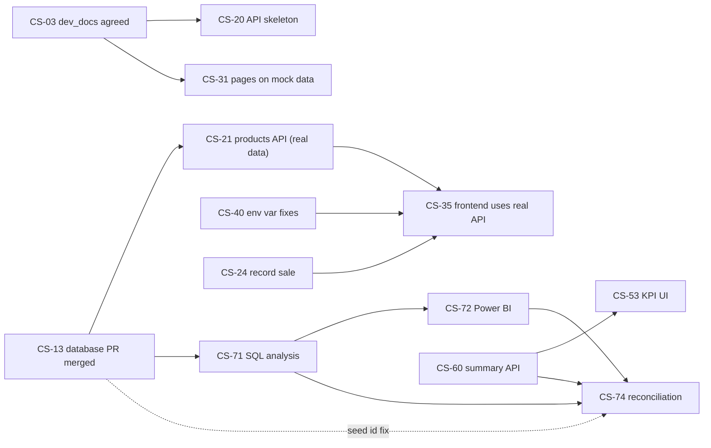

# 12. Sprint Plan and Backlog

| | |
|---|---|
| **Sprint 1** | Fri 9 – Thu 15 Oct 2026: "Build the foundation" |
| **Sprint 2** | Fri 16 – Thu 22 Oct 2026: "Connect, analyse, polish" |
| **Board** | GitHub Projects. One issue per story, titled `[CS-24] Record a sale API`. |
| **Status** | Re-planned 13 Oct 2026 (Sprint 1 Day 3) to match actual progress |

Points: 1 = 1–2 h · 2 = half a day · 3 = a day · 5 = 2 days (8 = split it).

---

## 1. Where we are (13 Oct, Sprint 1 Day 3)

| Done | In progress / waiting | Not started |
|------|-----------------------|-------------|
| Repo structure, Compose, Dockerfiles, `.env.example`, CI build (PR #1 merged) | DB schema + seed + verify on `database` branch (PR pending) | Backend code |
| Frontend technical design | Backend design + docs (`dev_docs/`) | Frontend scaffold |
| Schema change request agreed and applied by Samuel | n/a | Analytics SQL, Power BI |

**Sprint 1 goal (unchanged):** *A user can add, edit and list products and record a sale that reduces stock, all running with Docker Compose.*

---

## 2. Sprint 1 backlog (remaining days: Tue 13 – Thu 15)

### Epic E0: Setup
| ID | Story | Owner | Pts | When | State |
|----|-------|-------|-----|------|-------|
| CS-01 | Repo structure, `.gitignore`, branch protection | Nana Yaw | 2 | D1 | ✅ (branch protection to confirm) |
| CS-02 | Project board, labels, Sprint 1 issues | Scrum Master | 2 | D1 | ⏳ |
| CS-03 | Agree schema, API endpoints, repo structure (`dev_docs` PR approved by all) | All | 2 | **D3** | ⏳ |

### Epic E1: Database (Samuel)
| ID | Story | Pts | When | State |
|----|-------|-----|------|-------|
| CS-10 | Schema `database/init.sql` (aligned) | 3 | D2 | ✅ on branch |
| CS-11/12 | Seed: 6 categories, 24 products, 200 sales | 3 | D2–3 | ✅ on branch |
| CS-13 | Move branch-root README to `database/README.md`; **fix seed id ordering** (04 §5); PR to `main` | 2 | **D3–4** | ⏳ |

### Epic E2: Backend (Joseph)
| ID | Story | Pts | When | AC |
|----|-------|-----|------|----|
| CS-20 | Skeleton: config, pool, `/api/health`, JSON 404 + error handler | 2 | **D3** | `/api/health` 200 (503 when DB down); JSON 404 and errors |
| CS-21/22/23 | Categories list + products CRUD, search, filters, sort, pagination | 3 | **D3–4** | product cases in [05 §10](05-api-reference.md#10-postman--curl-smoke-test) pass |
| CS-24 | Record sale with atomic stock decrement | 3 | **D4** | oversell → 409, stock unchanged; price copied |
| CS-25 | Sales list/get/correct/cancel | 2 | **D4–5** | stock moves by the difference; cancel restores |
| CS-26 | First automated tests + Postman collection | 2 | D5 | `npm test` green |

### Epic E3: Frontend (Cecilia)
| ID | Story | Pts | When |
|----|-------|-----|------|
| CS-30 | Vite + React scaffold, routing, layout, `npm start` = `vite --port 3000` | 2 | **D3** |
| CS-31 | Product list/cards with mock data shaped like 05 §5.1 | 2 | D3 |
| CS-32/33 | Add/edit product form with field errors | 3 | D4 |
| CS-34 | Record Sale form | 3 | D4 |
| CS-35 | Switch products + sale form to the real API (with loading and error states) | 3 | D5 |

### Epic E4: DevOps (Nana Yaw)
| ID | Story | Pts | When |
|----|-------|-----|------|
| CS-40 | Env var fixes C1, C3, C4 ([09 §5](09-environment-and-setup.md#5-agreed-change-requests-devops-owner)) | 1 | **D3** |
| CS-41 | DB healthcheck + `depends_on: service_healthy` (C2) | 1 | D4 |
| CS-43 | README "Getting started" (09 §1) | 1 | D4–5 |

### Sprint 1 review (Thu 15 Oct)
Code freeze 13:00 → demo from `docker compose up`: add product → edit → list → record sale → stock decreased → oversell rejected. Then retrospective and a board screenshot.

---

## 3. Sprint 2 backlog

**Goal:** *The manager sees live KPIs, low-stock alerts and a Power BI dashboard whose numbers match the app, all checked by CI.*

| ID | Story | Owner | Pts | Days |
|----|-------|-------|-----|------|
| CS-50 | Search (debounced) + category filter UI | Cecilia | 3 | D1–2 |
| CS-51 | Low-stock badge, "Low stock only" filter, post-sale warning | Cecilia | 2 | D2 |
| CS-52 | Sales history page: filters, correct, cancel with confirm | Cecilia | 3 | D2–3 |
| CS-53 | Dashboard KPI cards + top 5 + date range | Cecilia | 3 | D2–3 |
| CS-54 | Polish: empty/success states, disable while saving, responsive, GHS format | Cecilia | 2 | D3 |
| CS-60 | `GET /api/summary` (definitions in 05 §7.2) | Joseph | 2 | D1 |
| CS-62 | Integration tests for all rules (08 §2) | Joseph | 3 | D1–2 |
| CS-63 | Swagger UI `/api/docs`, Postman collection, README endpoint table | Joseph | 2 | D3 |
| CS-70 | Read-only `analyst` role | Samuel | 1 | D1 |
| CS-71 | Analysis SQL files (by month, category, payment method; top products; low stock; KPI summary) | Samuel | 3 | D1–2 |
| CS-72 | Power BI dashboard | Samuel | 5 | D2–3 |
| CS-73 | Insights report (4–5 findings, 2–3 recommendations) | Samuel | 2 | D3–4 |
| CS-74 | **Reconciliation note** API = SQL = Power BI | Samuel + Joseph | 2 | D4 |
| CS-80 | CI: backend lint/test, DB scripts, frontend build, stack smoke (09 §4) | Nana Yaw | 3 | D1–2 |
| CS-81 | Make the CI checks required; CI badge in README | Nana Yaw | 1 | D2 |
| CS-82 | Hardening: `.dockerignore`, `npm ci`, remove `version:` (C5, C6, C8) | Nana Yaw | 2 | D3 |
| CS-83 | Fresh-clone test on another laptop; README troubleshooting | Nana Yaw + 1 | 2 | D4 |
| CS-90 | Shared README: overview, architecture, setup, endpoints, screenshots | All (Nana Yaw coordinates) | 3 | D3–4 |
| CS-91 | Screenshots: products, record sale, low stock, dashboard, Power BI, board | Cecilia + Samuel | 1 | D4 |
| CS-92 | Slides, demo script (08 §5), 2 timed rehearsals | All | 3 | D4–5 |
| CS-93 | Final board screenshot + retro notes | Scrum Master | 1 | D5 |

**Wed 21 Oct (Day 4): stabilisation.** No new features after 12:00. Bug fixes, reconciliation, fresh-clone test, rehearsal 1.
**Thu 22 Oct (Day 5): demo day.** Rehearsal 2; `git pull && docker compose up --build` on the demo laptop at least 1 h before; 15-minute presentation; retrospective.

---

## 4. Stretch (only when every story above is Done)

| ID | Story | Owner | Pts | API |
|----|-------|-------|-----|-----|
| CS-S1 | Export sales to CSV | Joseph + Cecilia | 3 | `GET /api/sales/export.csv` |
| CS-S2 | Revenue, last 7 days chart | Cecilia + Joseph | 3 | `GET /api/summary/daily?days=7` |
| CS-S3 | Login with admin/cashier roles | Joseph + Cecilia (+ Samuel: `users` table) | 8 → split | `POST /api/auth/login` |

Order: S1 → S2 → S3. Don't start S3 after Tue 20 Oct.

---

## 5. Dependencies

**How to avoid waiting on each other:** Cecilia uses mock data shaped exactly like 05. Joseph runs Samuel's SQL from the `database` branch locally until it is merged. Samuel can build the SQL files against his branch before the merge. Nana Yaw's env fixes don't depend on anyone.
